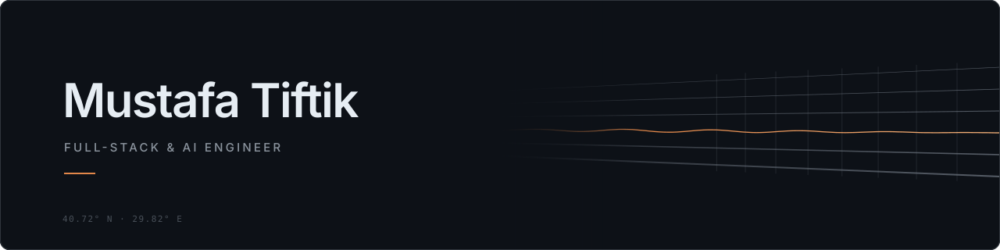

  <picture>
    <source media="(prefers-color-scheme: dark)" srcset="./assets/banner-dark.svg" />
    <source media="(prefers-color-scheme: light)" srcset="./assets/banner-light.svg" />
    
  </picture>

I build software for industrial work. Most of it lives between a database schema and a 3D viewport: data models, APIs, calculation engines, and the interfaces that engineers actually use on the job.

I've also spent two summers at a robotics company, writing fleet dashboards and then standing next to AGVs with a laptop, tuning PLC logic and lidar navigation before a production shipment. That time is the reason I care about software that holds up outside the browser.

---

### Now

**Full-Stack Engineer at Adencon** · sole developer of **SmartFurnace**

SmartFurnace is a SaaS platform for designing industrial vacuum furnaces and planning the factory floor around them. I've built it from an empty repository:

- a thermal and mechanical calculation engine
- a 3D factory layout planner in Babylon.js, with a WebXR walkthrough mode
- an interactive 3D assembly guide that stays linked to the bill of materials
- multi-tenant RBAC on NextAuth v5, plus a separate supplier portal with hand-rolled HMAC-SHA256 JWT auth
- PDF reports that combine 3D scene captures with rendered DOM, and a state-machine quote workflow for suppliers

`Next.js 16` `TypeScript` `PostgreSQL` `Prisma` `Babylon.js` · 27 data models · 59 API routes · 42K+ lines

---

### Selected work

| Project | What it does | Stack |
|---|---|---|
| **SmartFurnace** | Furnace design and factory layout planning, end to end | Next.js, PostgreSQL, Babylon.js |
| **News → Stock Movement** | Graduation thesis. Predicts next-day price direction from financial news by fusing FinBERT sentiment with BERTurk / ModernBERT-TR / ELECTRA embeddings. Chronological splits, tested on both BIST and S&P 500 | Python, PyTorch |
| **AGV Fleet Tool** | Internal tool for discovering, controlling and tasking a multi-AGV fleet over SSH and ROS2 | ROS2, Linux |
| **Social Library** | Social platform for books and films built on TMDb and Google Books, with a normalized PostgreSQL schema and JWT auth | Node.js, React, PostgreSQL |
| **Collaboration Graph** | Models academic co-authorship as a graph and computes shortest paths and collaboration metrics with an interactive view | Flask, React, Vis.js |

---

### Toolbox

**Languages** &nbsp; TypeScript · Python · JavaScript · SQL · Java · C / C++ 
**Web** &nbsp; Next.js · React · Node.js · Prisma · PostgreSQL · Babylon.js · Flask · shadcn/ui 
**ML** &nbsp; PyTorch · Transformers (BERT, ELECTRA) · NLP · pandas · NumPy 
**Industrial** &nbsp; Siemens PLC (TIA Portal, Safety Designer) · OPC / Kepware · ROS2 · lidar & IMU calibration 
**Infra** &nbsp; Docker · Vercel · Supabase · Linux · Git

---

<picture><source media="(prefers-color-scheme: dark)" srcset="https://raw.githubusercontent.com/MustafaTiftik/MustafaTiftik/output/snake-dark.svg" /><source media="(prefers-color-scheme: light)" srcset="https://raw.githubusercontent.com/MustafaTiftik/MustafaTiftik/output/snake-light.svg" /></picture>

B.Sc. Computer Engineering, Kocaeli University · Kocaeli, Türkiye · [LinkedIn](https://www.linkedin.com/in/mustafatiftik/)
